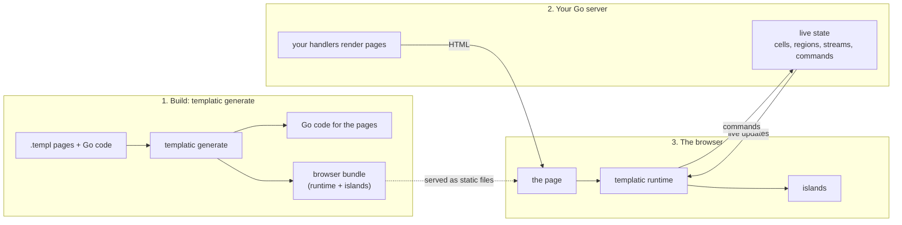

# templatic

[](https://pkg.go.dev/github.com/nkapatos/templatic)
[](https://github.com/nkapatos/templatic/actions/workflows/check.yml)

templatic makes web pages that stay up to date on their own. You build the
pages on the server in Go, and when something changes on the server (a
counter, a list, a status), every open page shows the change right away,
without a reload and without writing a JavaScript app.

It is a Go library built on [templ](https://templ.guide), the Go HTML
templating language. If you can write a templ page, you can write a templatic
page.

> templatic is in early development. APIs may change before the first release.

## The idea in plain words

Most interactive websites are two programs: a server that stores the data,
and a JavaScript app in the browser that draws the screen and keeps its own
copy of the data. Keeping the two in sync is where much of the work, and many
of the bugs, come from.

templatic keeps one program. The server holds the truth and draws the HTML.
The browser gets a small runtime that does three things:

1. **Listens.** Each open page keeps a connection to the server. When a value
   changes there, the server sends the new value or the new piece of HTML,
   and the page updates that spot in place.
2. **Sends.** When someone clicks a button or submits a form, the runtime
   sends the action to the server as a *command*. The server checks it,
   changes its state, and every page showing that state updates.
3. **Wakes up islands.** A part of the page that really needs code in the
   browser (a chart, a drag-and-drop list, a rich editor) can be an *island*:
   a small client component, loaded only where it is used.

Forms keep working without JavaScript: the same command also accepts an
ordinary form post, so a page falls back to plain HTML instead of breaking.

## How it works



1. **Build.** `templatic generate` turns your `.templ` files into Go code (as
   templ does) and builds the browser bundle: the runtime, your islands and
   your client code.
2. **Run.** Your Go program serves the pages. templatic gives it ordinary
   `net/http` handlers and middleware to plug in; your program stays in
   charge of the server, the routes and their order.
3. **Use.** The page loads, connects back to the server, and from then on
   stays live.

## The building blocks

| Name | What it is | Example |
|---|---|---|
| **Cell** | one live value; every page showing it updates when it changes | a visitor count |
| **Region** | a piece of HTML the server redraws and sends whole | a cart summary |
| **Stream** | a list the server adds items to | a chat or activity feed |
| **Command** | an action from the page, with typed, validated input | "add 3 to the count" |
| **Island** | a client component for the parts that need browser code | a chart |

## Get started

You need [Go](https://go.dev/dl/) 1.27 or newer and
[Node.js](https://nodejs.org/) with npm (for the browser bundle).

```sh
go install github.com/nkapatos/templatic/cmd/templatic@latest
templatic init myapp
cd myapp
go mod tidy
npm install
go tool templatic generate
go run .
```

Open <http://localhost:8080>. The starter app is a counter: open it in two
browser windows, add to the count in one, and watch the other update.

While you work, run `npm run dev` (or `mise run dev`). It rebuilds when you
save, restarts the server when Go code changes, and reloads open pages.

A `templatic` binary built from a checkout of this repository has no release
version; point the new app at the checkout instead:
`templatic init -replace /path/to/templatic myapp`.

## What the starter app shows

A command, declared once with its input and its validation:

```go
type AddIn struct {
	N int `json:"n"`
}

func (in AddIn) Validate() error {
	if in.N < -100 || in.N > 100 {
		return live.Invalid("n", "pick a step between -100 and 100")
	}
	return nil
}

var Add = live.NewCommand[AddIn]("count.add")
```

A page with a live cell and a form that posts the command to `/add`, with
JavaScript or without it:

```templ
<p>Count: <strong>@ui.Cell(count)</strong></p>
@ui.FormFor(Add, "/add", failed) {
	<input name="n" type="number" value={ ui.FieldValue(ctx, "n", "1") }/>
	@ui.FieldError("n")
	<button type="submit">Add</button>
}
```

And the server side that changes the cell, one function for both: with
JavaScript the page stays and updates live, without it the browser is sent
back to `/`:

```go
count := live.NewCell(w, "count", 0)
mux.Handle("POST /add", components.Add.Form(w,
	func(r *http.Request, s *live.Session, in components.AddIn) (string, error) {
		count.Update(func(v int) int { return v + in.N })
		return "/", nil
	}, invalid))
```

## What it is not

- **Not a server or app framework.** Your program owns `main`, the HTTP
  server, the router and the middleware. templatic hands you parts to mount.
- **Not a single-page app framework.** There is no client-side router;
  navigation is ordinary page loads, or in-place swaps with `ui.Link`.
- **Not a JavaScript UI framework.** Islands are opt-in, only where a page
  needs browser code.
- **Not tied to a CSS or app build tool.** Bring your own.

An optional pages router lives under `experimental/` and may change.

## Serve it over HTTP/2 or HTTP/3

Each open page keeps one connection to the server for its live updates.
Over HTTP/1.1, browsers allow only six connections per site, shared by all
tabs, so a seventh tab of the app waits until one closes. HTTP/2 and HTTP/3
carry every page's stream over one connection and lift that limit.

Browsers speak HTTP/2 and HTTP/3 only over TLS. Serve the app behind a
proxy or load balancer that terminates TLS (Caddy, nginx, a cloud load
balancer), or serve TLS from Go itself: `http.Server.ListenAndServeTLS`
speaks HTTP/2 without further setup. Plain HTTP/1.1 is fine for local
development with a few tabs.

## Where generated files go

- `*_templ.go` and `*_tc.go` sit beside your `.templ` files. Commit them, as
  with templ.
- `.templatic/` at the root of your module holds everything else templatic
  generates: the runtime, the island modules, typed commands for TypeScript
  and the built bundle in `.templatic/dist`. It is ignored by git and safe to
  delete (`templatic clean`).

templatic never overwrites your own files. It creates a starter file for an
island (`client/islands/{tag}.ts`) only when there is none. To ship a single
binary, embed the bundle with `//go:embed all:.templatic/dist`.

The browser runtime uses [idiomorph](https://github.com/bigskysoftware/idiomorph),
and islands can use [Lit](https://lit.dev). Both are ordinary npm
dependencies of your app: `templatic init` adds them at tested versions, and
`templatic generate` prints the `npm install` command when an installed
version is outside the supported range.

## Plugins

`templatic generate` bundles the browser code with esbuild, and plugins can
hook into that build. templatic ships three: `budget` (fails the build when a
bundle grows past a size limit), `env` (passes environment variables with a
chosen prefix to client code) and `sri` (subresource integrity hashes). To
use plugins, give your app its own small build program that runs the whole
templatic command line with them:

```go
func main() {
	os.Exit(cli.Main(os.Args[1:], os.Stdout, os.Stderr, cli.With(sri.New())))
}
```

## Packages

| Package | Role |
|---|---|
| `templatic` | handlers and middleware, asset manifest, `Head`, `Boot` |
| `ui` | components used in templ markup (`ui.Cell`, `ui.FormFor`, `ui.Island`, …) |
| `live` | server state: cells, regions, streams, commands, sessions |
| `live/livetest` | test helpers |
| `generate` | the build step and the plugin API |
| `plugins/*` | first-party plugins: `budget`, `env`, `sri` |
| `cli` | the command line: `generate`, `dev`, `init`, `check-ts`, `clean` |
| `cmd/templatic` | the `templatic` binary |
| `experimental/pages`, `experimental/routes` | optional pages router |

## Design

How templatic is put together, the rules it keeps and why: [design.md](design.md).

## Develop templatic

```sh
mise run build   # bin/templatic
mise run check   # every check: format, tidy, vet, lint, vulnerabilities,
                 # Go and TypeScript tests, typecheck, public API report,
                 # clean tree
```

Conventions and the release process are in [AGENTS.md](AGENTS.md); see also
[CONTRIBUTING.md](CONTRIBUTING.md).

## License

MIT.

## Acknowledgements

templatic builds on, and borrows ideas from, these projects:

- [templ](https://templ.guide): the template language and compiler templatic
  extends.
- [Phoenix LiveView](https://github.com/phoenixframework/phoenix_live_view):
  server-held state that drives the page, and server-declared URLs on
  updates.
- [Hotwire Turbo](https://turbo.hotwired.dev): plain page loads as the
  fallback that always works.
- [Astro](https://astro.build): islands, client code only where a page
  needs it.
- [htmx](https://htmx.org) and [Livewire](https://livewire.laravel.com):
  hypermedia-driven pages, and lessons on browser history.
- [idiomorph](https://github.com/bigskysoftware/idiomorph),
  [Lit](https://lit.dev) and [esbuild](https://esbuild.github.io): the
  libraries templatic uses in the browser and in the build.
